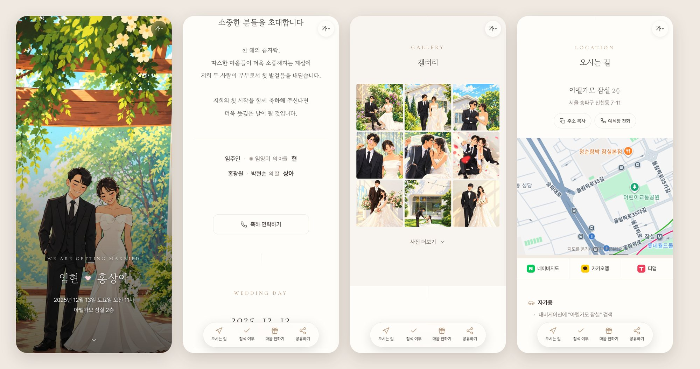

# 💌 모바일 청첩장 템플릿 (무료 · 광고 없음)



<p align="center">
  👉 <a href="https://hyunim.github.io/wedding-invitation/"><b>데모 청첩장 보기</b></a> (휴대폰으로 열어보세요)
  · <a href="https://hyunim.github.io/wedding-invitation/?preview">방명록·참석 기능까지 전체 보기</a><br>
  <sub>예시는 템플릿 제작자의 실제 청첩장이에요. 사진은 AI 일러스트로 바꾸고, 계좌번호는 가짜로 넣고 연락처는 비워뒀어요.</sub>
</p>

## 🙋 코딩 몰라도 AI 에게 한 줄이면 돼요

ChatGPT · Claude · Gemini 처럼 **링크를 읽을 수 있는 AI** 에게 이렇게 보내세요.

```
https://github.com/HyunIm/wedding-invitation 참고해서 모바일 청첩장 만들어줘
```

AI 가 필요한 정보를 하나씩 물어보고, 어디를 눌러야 하는지 차근차근 알려줘요.

**준비물:** GitHub 계정(무료) · 사진 · 예식 정보 · 컴퓨터(휴대폰도 되지만 컴퓨터가 훨씬 편해요)

---

## ✨ 들어있는 기능

| 기본 기능 | 더 편해진 점 |
|---|---|
| 표지 · 인사말 · 혼주 성함(고인 국화/故 표시) | 🔠 어르신을 위한 **글씨 크게** 버튼 |
| 달력 · D-day · 내 캘린더에 추가 | 📱 하단 **빠른 메뉴** (오시는 길 · 참석 · 계좌 · 공유) |
| 갤러리 (바둑판 / 벽돌형 / 넘겨보기) | 📷 **사진을 폴더에 올리기만 하면** 갤러리 완성 (자동 용량 줄이기 · 위치정보 삭제) |
| 지도 · 네이버지도 / 카카오맵 / 티맵 길찾기 | 👆 휴대폰 **뒤로가기로 사진·창 닫기** |
| 교통 · 주차 · 안내사항 | 🛡️ 설정 실수해도 **기존 청첩장은 안 깨짐** (배포 전 자동 검사) |
| 참석 의사(RSVP) · 방명록 → 구글 시트 | 🙈 설정 안 한 기능은 손님에게 자동으로 숨김 |
| 계좌 복사 · 카카오페이 · 카카오톡 공유 | 🎨 색상 테마 6가지 · 글꼴 3가지 · 꽃잎/눈 효과 |

---

## 📋 만드는 순서

> AI 가 이 순서대로 안내해줘요. 직접 해도 돼요.
> 아래 주소의 `내아이디` 와 `저장소이름` 은 내 것으로 바꿔서 여세요.

1. **GitHub 가입** — https://github.com/signup
2. **내 청첩장 저장소 만들기** — https://github.com/new?template_name=wedding-invitation&template_owner=HyunIm
   - Repository name 에 영어 소문자로 이름 입력 (예: `wedding`) → **Public** → **`Create repository`**
   - 💡 이때 Actions 탭에 빨간 ❌ 가 하나 생길 수 있어요. 다음 단계 전에 실행돼서 그런 거라 **정상이에요.**
3. **인터넷 공개 켜기** — `https://github.com/내아이디/저장소이름/settings/pages`
   - **Source** 를 **`GitHub Actions`** 로 바꾸기
4. **예시 사진 지우기** — `https://github.com/내아이디/저장소이름/tree/main/demo`
   - 오른쪽 위 **`···`** → **`Delete directory`** → **`Commit changes`**
5. **내 사진 올리기** — `https://github.com/내아이디/저장소이름/upload/main/images`
   - 표지 사진 1장을 **`cover.jpg`** 로 이름을 바꿔 올리기 (카톡 미리보기용 `og.jpg`, 마지막 사진 `closing.jpg` 는 선택)
   - 갤러리 사진은 `https://github.com/내아이디/저장소이름/upload/main/images/gallery` 에 **한꺼번에** 끌어다 놓기
   - 휴대폰 원본 그대로 OK · 갤러리 순서는 파일 이름 순서
6. **청첩장 내용 넣기** — `https://github.com/내아이디/저장소이름/edit/main/config.js`
   - 안의 글을 **전부 지우고** AI 가 만들어준 내용을 붙여넣기 → **`Commit changes`**
7. **완성 확인** — `https://github.com/내아이디/저장소이름/actions` 에 초록 ✅ 가 뜨면 (1~2분)
   - 👉 `https://내아이디.github.io/저장소이름/` 이 내 청첩장 주소예요!

---

## 🤖 AI 도우미 안내 (For AI assistants)

사용자가 이 저장소 링크를 주며 청첩장을 만들어 달라고 했다면, 아래대로 진행해 주세요.
The person is most likely **not a developer**. Follow this guide.

**말투와 진행 방식**
- 한국어로, 쉬운 말로, **한 번에 한 단계씩** 안내하고 "했어요" 를 기다린 뒤 다음으로 넘어가세요.
- 터미널·git·설치 프로그램은 쓰지 않아요. **모든 작업은 GitHub 웹사이트에서** 클릭만으로 끝나요.
- 위 **📋 만드는 순서** 의 주소에 사용자의 GitHub 아이디와 저장소 이름을 넣어 **바로 누를 수 있는 링크**로 주세요. (주소의 아이디 부분 `내아이디.github.io` 는 소문자)
- 비밀번호·인증번호는 절대 묻지 마세요.
- 지금 쓰는 AI 서비스에 GitHub 플러그인·커넥터가 있다면, 시작할 때 연결을 추천하세요.

**1단계 — 정보 모으기** (한 번에 3~4개씩 질문, 모르는 건 건너뛰기)
- 신랑·신부 이름(성 포함) / 부모님 성함 / 고인 여부 / 관계(장남·차녀·아들·딸 등)
- 예식 날짜·시간 / 예식장 이름·층·홀 / 주소 / 예식장 전화번호
- 인사말 (원하면 분위기에 맞게 2~3가지 초안 제안)
- 연락처 · 계좌번호 · 카카오페이 송금 링크 (선택, 사용자가 직접 알려준 값만 사용)
- 교통편 · 주차 · 식사 · 화환 등 안내사항 (선택)
- 디자인: 색상 `ivory` `blush` `sage` `navy` `mono` `lavender` / 글꼴 `serif` `sans` `hand` / 표지 `full` `arch` `frame` / 효과 `none` `petal` `snow` `sparkle`
- 지도 좌표(`lat`, `lng`): 확실히 알 때만 넣고, 아니면 "구글지도에서 예식장을 마우스 오른쪽 클릭하면 맨 위에 나오는 숫자" 를 알려달라고 하세요.

**2단계 — GitHub 준비** — 📋 만드는 순서 1~5 를 안내하세요. 사진 이름 바꾸기가 어렵다면 올린 파일 이름을 물어보고 `cover.image` 에 그 이름을 넣어도 돼요.

**3단계 — config.js 만들기**
1. 원본을 읽으세요: https://raw.githubusercontent.com/HyunIm/wedding-invitation/main/config.js
   (못 읽으면 사용자에게 이 링크를 열어 전체 내용을 복사해 붙여달라고 하세요.)
2. **구조·주석·따옴표·쉼표는 그대로** 두고 값만 바꾸세요. 예시 값(임현, 홍상아, 아펠가모 잠실 등 제작자 정보)은 **하나도 남기지 마세요.**
3. 형식: `date: 'YYYY-MM-DD'`, `time: 'HH:MM'` (24시간, 한국시간), 전화 `'010-1234-5678'`, 여러 줄 글은 백틱(`` ` ``).
4. 정보가 없는 기능은 키를 지우지 말고 `enabled: false` 로 끄거나 `''` 로 비우세요. 전화번호·계좌번호는 **절대 지어내지 마세요.**
5. 사진 경로(`images/...`)와 `gallery.images: []` 는 그대로 두세요. (갤러리는 폴더에서 자동으로 불러와요)
6. **수정한 config.js 전체를 코드 블록 하나로** 빠짐없이 출력하고, 📋 6번 링크에 붙여넣도록 안내하세요.

**4단계 — 확인** — 📋 7번. Actions 에 ❌ 가 있으면 눌러서 나온 빨간 글을 복사해 달라고 한 뒤 원인을 고쳐주세요. 저장소를 처음 만들 때 생긴 ❌ 는 무시해도 돼요.

**추가 기능 (원할 때만)** — 방명록·참석 의사: [방명록 설정](docs/guestbook-rsvp.md) · 카카오톡 공유 버튼: [카카오 설정](docs/kakao-share.md) · 배경음악: `images/bgm.mp3` 를 올리고 `music.enabled: true`

**나중에 고칠 때** — 📋 6번 링크에서 현재 config.js 내용을 복사해 달라고 한 뒤, 바꾼 **전체 파일**을 다시 주세요.

---

## 📚 더 알아보기

| 문서 | 내용 |
|---|---|
| [사진·음악](docs/photos.md) | 사진 크기, 순서, 아이폰 사진 |
| [AI 로 고치기](docs/edit-with-ai.md) | 나중에 내용·디자인을 바꿀 때 쓰는 질문 모음 |
| [방명록·참석여부](docs/guestbook-rsvp.md) | 구글 시트로 응답 받기 (무료, 5분) |
| [카카오톡 공유](docs/kakao-share.md) | 카톡 공유 버튼 · 미리보기 사진 |
| [문제 해결](docs/troubleshooting.md) | "화면이 안 바뀌어요" 등 자주 묻는 질문 |

## 📜 라이선스
- **코드·문서:** MIT — 자유롭게 쓰고, 고치고, 나눠주세요.
- **예시 그림 (`demo/` 폴더, `docs/preview.jpg`):** 실제 인물을 그린 것이라 MIT 에 포함되지 않아요. 내 청첩장을 만들 땐 `demo/` 폴더를 지우고 내 사진을 올려주세요. ([LICENSE](LICENSE))

행복한 결혼 되세요! 💐
